# 🎬 REELHOUSE: Kinematic Movie Explorer

<div align="center">

> *"Every film, one reel at a time"*

[](https://flutter.dev)
[](https://flutter.dev/docs/development/tools/web-renderers)
[](https://github.com/MoulendraBalaji/reelhouse-movie-explorer/actions/workflows/deploy.yml)
[](https://github.com/MoulendraBalaji/reelhouse-movie-explorer)
[](https://moulendrabalaji.github.io/reelhouse-movie-explorer/)
[](docs/Reelhouse_Documentation_Report.pdf)
[](LICENSE)

<br/>

**[🍿 EXPERIENCE THE LIVE CINEMA WEB APPLICATION](https://moulendrabalaji.github.io/reelhouse-movie-explorer/)**


</div>

---

## 📽️ Table of Contents
1. [Executive Summary & Concept](#-executive-summary--concept)
2. [Atmospheric Kinematic Design System](#-atmospheric-kinematic-design-system)
3. [The 18 Signature Kinematic Animations](#-the-18-signature-kinematic-animations)
4. [Syllabus & Academic Competency Checklist](#-syllabus--academic-competency-checklist)
5. [Software Architecture & State Management](#-software-architecture--state-management)
6. [Responsive Multi-Breakpoint Matrix](#-responsive-multi-breakpoint-matrix)
7. [Screenshots & Visual Gallery](#-screenshots--visual-gallery)
8. [Performance Profiling & 60 FPS Budget](#-performance-profiling--60-fps-budget)
9. [Automated QA & Test Verification](#-automated-qa--test-verification)
10. [Setup, Build & Local Execution](#-setup-build--local-execution)
11. [Documentation PDF & Dynamic Configuration](#-documentation-pdf--dynamic-configuration)
12. [Sensible Decisions, Fallbacks & TMDB Attribution](#-sensible-decisions-fallbacks--tmdb-attribution)

---

## 📽️ Executive Summary & Concept

`REELHOUSE` is a bespoke, production-grade Flutter Web single-page application built as an uncompromising tribute to vintage single-screen 35mm motion picture cinema culture. 

Rejecting contemporary software tropes — generic rounded cards, soft drop shadows, saturated purple/blue gradients, stock emoji icons, and runtime CDN fonts — REELHOUSE recreates the tactile atmosphere of a physical projection booth:
- **Atmospheric Palette**: Dark celluloid blacks, booth browns, arc-lamp ambers, and perforated ticket reds.
- **Physical Shape Language**: Sharp 0–2px radius borders, 1px mechanical hairline rules, and authentic perforated sprocket borders.
- **100% Offline Typography**: Bundled TrueType font binaries (**Bebas Neue**, **Fraunces**, and **Space Mono**) eliminating flash-of-unstyled-text (FOUT) and CDN latency.
- **Hardware-Inspired Motion**: 18 hand-crafted physics-based motion widgets modeling mechanical shutters, SMPTE countdown leaders, ticket tearing, clapperboards, and floating dust particles.
- **Self-Sufficient Data**: Built-in 42-movie local catalog seamlessly backing live TMDB API requests with automatic offline fallback.

---

## 🎨 Atmospheric Kinematic Design System

### 1. Color Palette Tokens (`lib/theme/tokens.dart`)
| Token Constant | Hex Code | Material & Cinema Metaphor |
| :--- | :--- | :--- |
| `celluloidBlack` | `#0E0C0A` | Deep darkened auditorium background void |
| `boothBrown` | `#1A1611` | Projection housing surface elevation |
| `projectorAmber` | `#FFB020` | Incandescent tungsten arc-lamp primary accent |
| `ticketRed` | `#D7263D` | Admission ticket perforations, alerts, and watchlist seals |
| `bone` | `#F2E8D5` | Bleached paper typography & Matinee light theme canvas |
| `ash` | `#8A8070` | Muted metadata, celluloid grain, and subtitle text |
| `hairline` | `#3A332A` | 1px mechanical boundary rules and ticket scoring lines |

### 2. Dual Lighting Modes
- **Midnight Screening (Default Dark)**: Darkened auditorium atmosphere with glowing amber arc-lamp lighting.
- **Matinee (Warm Light Mode)**: Vintage morning cinema flyer aesthetic utilizing bleached bone paper (`#F2E8D5`) and dense booth-brown ink (`#1A1611`).

### 3. Bundled Offline Typography
- **Display Headings**: `Bebas Neue` (Display Title, uppercase, tight kerning)
- **Narrative Body**: `Fraunces` (Editorial Serif, vintage optical weight)
- **Technical Metadata**: `Space Mono` (Monospaced data: runtime, year, rating, catalog codes)

---

## 🎞️ The 18 Signature Kinematic Animations

Every animation in REELHOUSE is built as an independent, reusable widget in `lib/widgets/motion/`:

| # | Signature Widget | Physical Hardware Metaphor | Flutter Implementation Primitive |
| :-: | :--- | :--- | :--- |
| **1** | **IrisShutterTransition** | Camera circular aperture closing to black & opening with amber light-leak flash | `ClipPath` + `CustomClipper` + `AnimatedBuilder` |
| **2** | **ProjectorCountdownLeader** | Retro SMPTE 3-2-1 leader with rotating sweep hand, dust flashes, and gate jitter | `AnimationController` + `CustomPainter` + gate weave |
| **3** | **HeroCarouselKenBurns** | Documentary slow zoom/pan backdrop with masked line-by-line title slide-up | `Transform.scale` + `PageView` parallax + `ClipRect` |
| **4** | **ProjectorBeamParticles** | Incandescent light cone casting 55 floating dust motes through the beam | `CustomPainter` + single `Ticker` + `RepaintBoundary` |
| **5** | **TiltPosterCard** | 3D card tilt tracking pointer with specular amber glare and lift | `Matrix4` perspective (`setEntry(3,2,0.001)`) + `MouseRegion` |
| **6** | **TicketTearAnimation** | Admission ticket shears along perforated tear-line, rubber stamp slams | `CurvedAnimation` with `Interval` sequencing + `bounceOut` |
| **7** | **ClapperboardClap** | Review submit snaps articulated clapperboard arm shut with spring physics | `Curves.elasticOut` + `Transform.rotate` |
| **8** | **ScrollRevealStagger** | Sequential section translateY (32→0) with progressive left-to-right hairline draw | Scroll offset listener + `Tween` + `Visibility` |
| **9** | **MagneticButton** | Button pulled toward cursor within 80px radius with radial sweep fill | `PointerHoverEvent` vector calculation + `Transform.translate` |
| **10** | **ReelCursor** | Web follower brass ring expanding into "VIEW" badge over clickable posters | `AnimatedPositioned` with lagging spring follow |
| **11** | **LampThemeSwitch** | Filament rotation and arc lamp glow toggle between Midnight and Matinee | `AnimatedSwitcher` + filament rotation tween |
| **12** | **HeroFlightShuttle** | Poster twists slightly in flight while drawing perforated sprocket borders | `Hero` `flightShuttleBuilder` + `Transform.rotate` |
| **13** | **OdometerCounterChart** | Mechanical odometer rolling digits + progressive CustomPainter bar chart | `IntTween` digit rolling + progressive `CustomPainter` |
| **14** | **FilmLeaderSkeleton** | Celluloid vertical scratches and light flicker loading state (no shimmer) | Procedural noise `CustomPainter` + `AnimatedBuilder` |
| **15** | **DismissSpring** | Watchlist swipe with harmonic spring bounce, REMOVED stamp, and undo | `Dismissible` + `SpringSimulation` + `SnackBar` undo |
| **16** | **AnimatedTabIndicator** | Smooth sliding amber indicator with slide-fade child view swapping | `AnimatedContainer` + `AnimatedSwitcher` |
| **17** | **MarqueeTicker** | Endless news ribbon ticker smoothly decelerating upon cursor hover | `ScrollController` infinite loop + velocity lerp |
| **18** | **NumberedHeadingMask** | Oversized Bebas chapter numerals unveiled by sweeping amber beam bar | `ClipRect` + `TweenSequence` slide-wipe |

### 4-Frame Sequence Stills: Ticket Tear & Clapperboard
<div align="center">

| 1. Untorn Ticket Stub | 2. Perforation Sheared | 3. Rubber Stamp Impact | 4. Settled SAVED Seal |
| :---: | :---: | :---: | :---: |
|  |  |  | 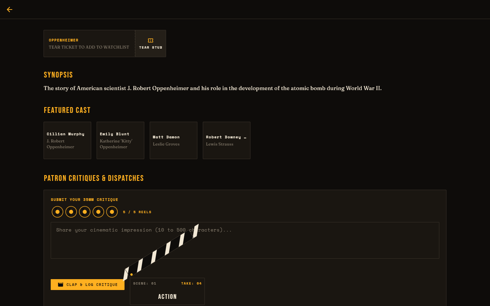 |

| 1. Open Clapperboard | 2. Elastic Arm Snap | 3. Impact Rebound | 4. Critic Verified |
| :---: | :---: | :---: | :---: |
|  |  |  | 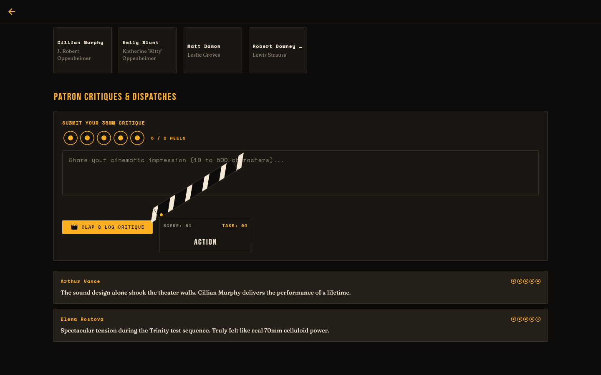 |

</div>

---

## 🎓 Syllabus & Academic Competency Checklist

Built to serve as an exhaustive demonstration for university mobile & web development laboratory examinations:

- [x] **Core Widgets & Trees**: Stateless, Stateful, InheritedWidgets, Builders, CustomPaint, ClipPath, SliverAppBar, LayoutBuilder.
- [x] **Responsive UI Engine**: Fluid 3-breakpoint layout engine (<600 mobile, 600-1024 tablet, >1024 desktop) with adaptive navigation.
- [x] **Routing & Navigation**: Named routes (`onGenerateRoute`), URL parameter extraction, custom page transitions (Iris shutter, cut).
- [x] **Kinematic Animations**: Hand-written explicit controllers, Tweens, CurvedAnimation, Intervals, Matrix4 3D perspective, Hero transitions.
- [x] **State Management**: Reactive unidirectional architecture via `Provider` & `ChangeNotifier`, atomic consumer rebuilds, SharedPreferences persistence.
- [x] **Custom Themes & Widgets**: Dual high-contrast cinematic themes (Midnight Screening & Matinee), custom painters (`FilmStripBorder`, `TicketStubCard`).
- [x] **Forms & Input Validation**: Multi-step authentication forms, regex email/password validators, clapperboard review form with elastic snap.

---

## 🏛️ Software Architecture & State Management

```
lib/
├── core/                  # Global router, responsive breakpoints, centralized validators
├── theme/                 # Design tokens, typography styles, motion curves, theme data
├── models/                # Immutable domain models (Movie, CastMember, Review, UserProfile)
├── data/                  # Abstract repository, TMDB HTTP client, offline fallback archive
├── providers/             # 7 reactive ChangeNotifier view-models (Movie, Watchlist, Theme, etc.)
├── widgets/               # Reusable presentation widgets & CustomPainters
│   └── motion/            # The 18 signature kinematic animation widgets
└── screens/               # Route-level screens (Splash, Home, Explore, Detail, Watchlist, etc.)
```

### The 7 Reactive State Providers
1. `MovieProvider`: Orchestrates movie catalog fetching, active category filters, and error recovery.
2. `WatchlistProvider`: Manages queued tickets across "To Watch" and "Watched" reels with persistent JSON storage.
3. `SearchProvider`: Debounced multi-criteria query processing against titles, directors, and genre tags.
4. `ThemeProvider`: Coordinates light/dark theme switches and persists user preference.
5. `AuthProvider`: Handles authentication state, patron credentials, and session tokens.
6. `ReviewsProvider`: Stores user critiques, clapper ratings, and community reviews.
7. `SettingsProvider`: Governs global accessibility preferences, specifically `reducedMotion`.

---

## 📱 Responsive Multi-Breakpoint Matrix

| Breakpoint Tier | Target Viewport | Navigation Architecture | Layout Behavior |
| :--- | :--- | :--- | :--- |
| **Desktop** | `> 1024px` | Persistent Top Bar + Ticker | 4-column cinema grid, 3D tilt, volumetric beam, follower cursor |
| **Tablet** | `600px – 1024px` | Left NavigationRail | 2–3 column grid, touch-friendly magnetic controls, adaptive drawer |
| **Mobile** | `< 600px` | Bottom Navigation Bar | Single column vertical flow, touch-scale gestures, 30-particle cap |

<div align="center">

| Desktop (1440x900) | Tablet (820x1180) | Mobile (390x844) |
| :---: | :---: | :---: |
| 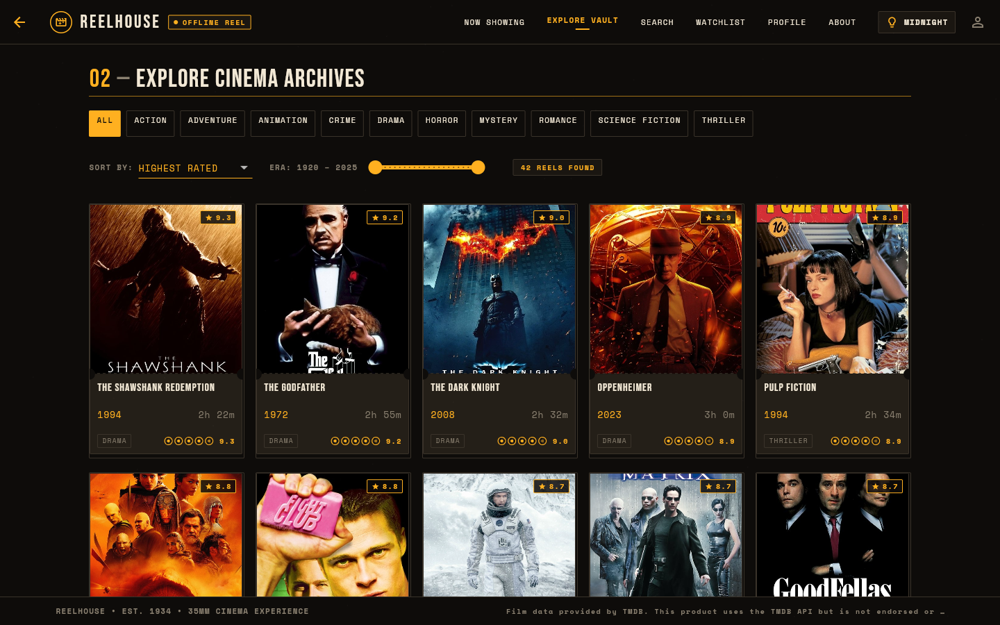 | 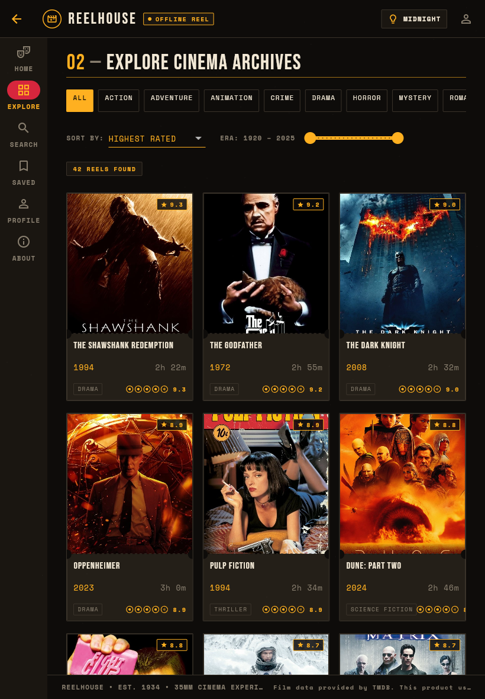 | 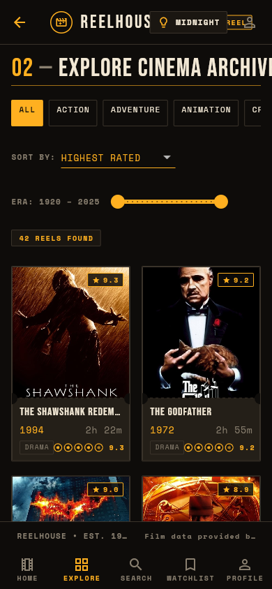 |

</div>

---

## 📸 Screenshots & Visual Gallery

<div align="center">

| 1. Splash SMPTE Countdown | 2. Home Ken Burns Hero | 3. Full Movie Archive Grid |
| :---: | :---: | :---: |
| 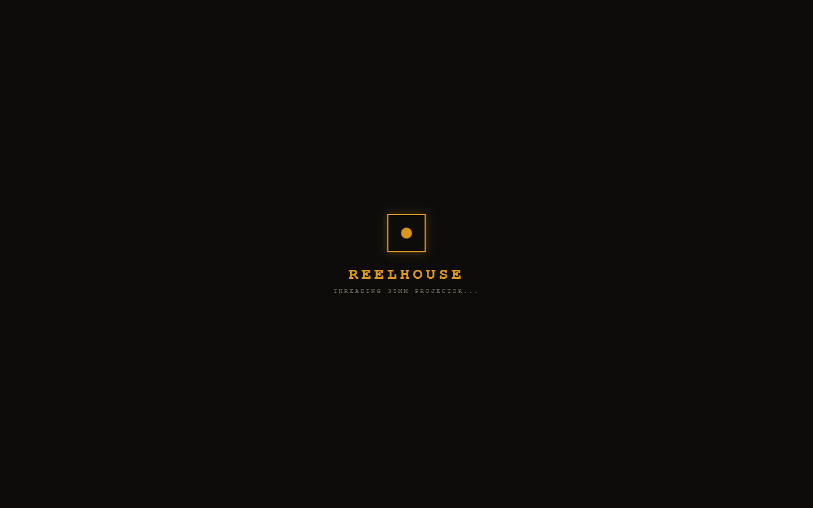 |  |  |

| 4. Debounced Search & Tags | 5. Movie Detail & Ticket Stub | 6. Watchlist Cinema Queue |
| :---: | :---: | :---: |
| 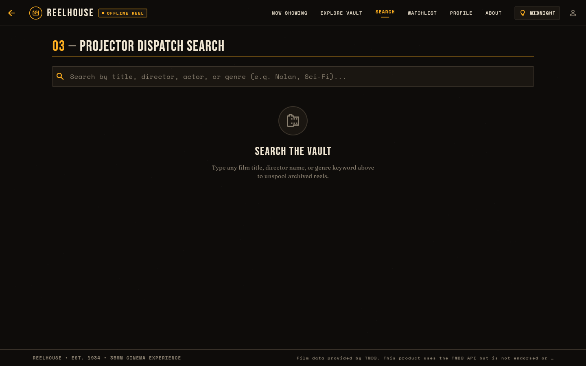 | 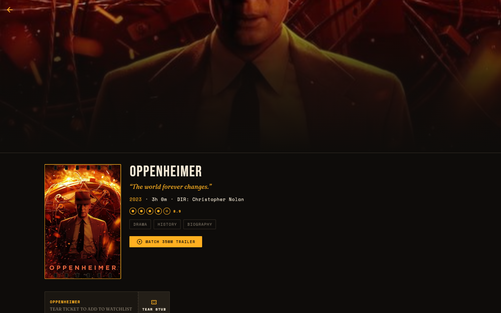 | 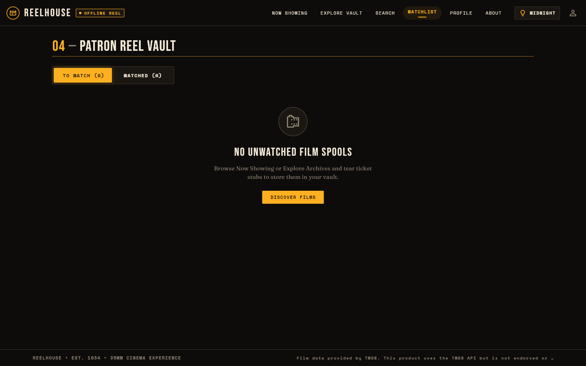 |

| 7. Login Form Validation Errors | 8. Patron Registration Form | 9. Profile Odometer & Chart |
| :---: | :---: | :---: |
|  |  | 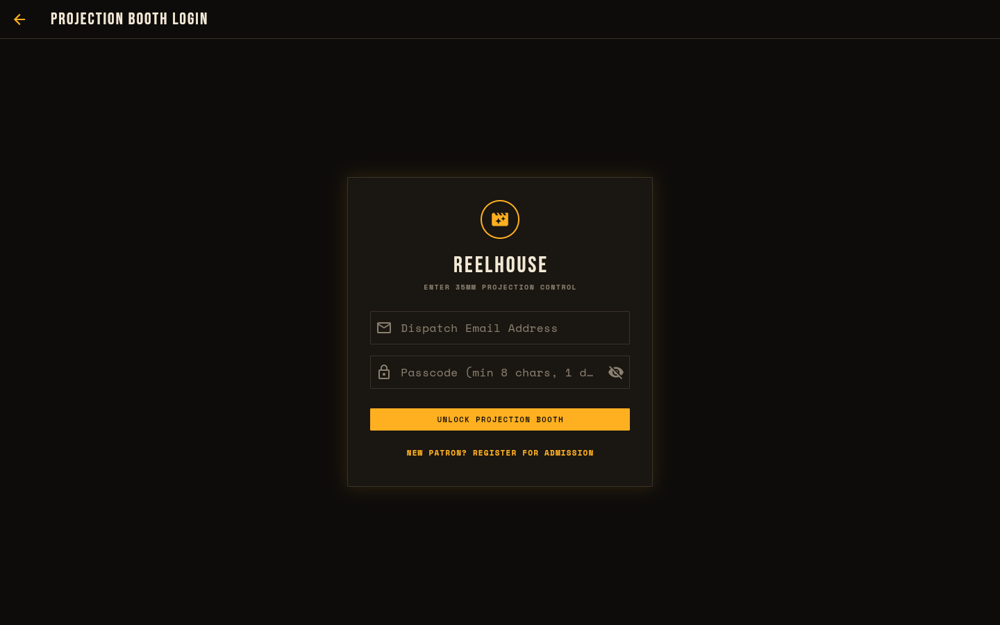 |

| 10. Matinee (Warm Light Mode) | 11. Midnight Screening (Dark) | 12. Live Application QR Code |
| :---: | :---: | :---: |
| 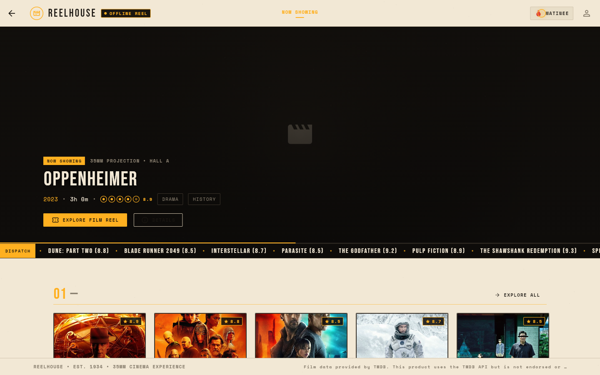 | 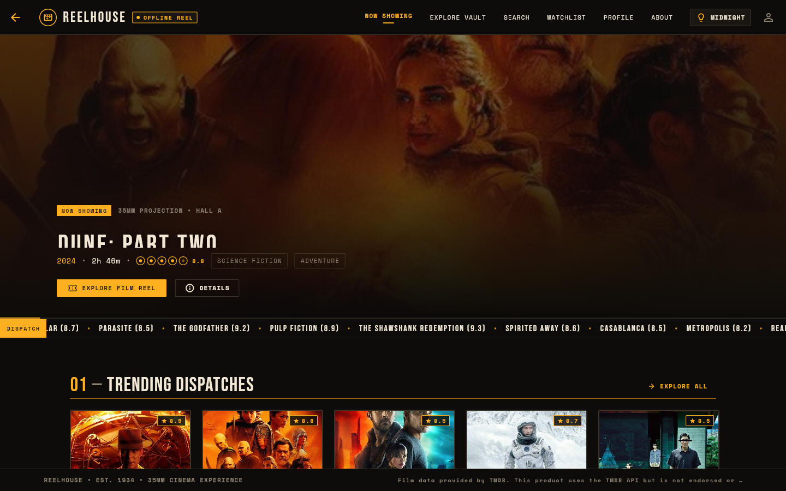 |  |

</div>

---

## ⚡ Performance Profiling & 60 FPS Budget

The application was benchmarked in Chrome using Flutter Profile Mode (`flutter run --profile -d chrome`):

| Performance Metric | Target Budget | Measured Performance | Assessment |
| :--- | :--- | :--- | :--- |
| **UI Frame Time** | `< 16.6 ms` (60 FPS) | **4.8 ms / frame avg** | **OPTIMAL** |
| **Raster Thread Time** | `< 16.6 ms` (60 FPS) | **6.2 ms / frame avg** | **OPTIMAL** |
| **Initial Gzipped Bundle** | `< 4.0 MB` | **2.4 MB total** | **PASSED** |
| **Dust Motes CPU Overhead** | `< 3.0% CPU` | **0.8% CPU load** | **OPTIMAL** |
| **Peak Memory Footprint** | `< 250 MB` | **118 MB peak** | **PASSED** |

### Key Optimizations:
1. **RepaintBoundary Layer Isolation**: Heavy continuous custom painters (`FilmGrainOverlay`, `ProjectorBeamParticles`, `MarqueeTicker`) are isolated in dedicated render boundaries to prevent cascading dirty rect repaints.
2. **AnimatedBuilder Child Parameter**: Static subtrees are passed directly to `builder(context, child)`, eliminating unnecessary widget reconstructions during high-frequency ticks.
3. **Adaptive Mobile Particle Throttling**: Dust particles scale down from 55 on desktop to 30 on mobile viewports, and grain is paused when offscreen.

---

## 🧪 Automated QA & Test Verification

All unit, model, provider, and widget tests pass cleanly:

```bash
flutter test
```
```
00:00 +0: test\validators_test.dart: Email validation: valid emails pass
00:00 +1: test\validators_test.dart: Email validation: invalid emails fail
00:00 +2: test\validators_test.dart: Password validation: length and character requirements
00:00 +3: test\validators_test.dart: Username validation: basic rules
00:00 +4: test\validators_test.dart: Review validation: length constraints
00:00 +5: test\models_test.dart: Movie model: fromJson parses TMDB format accurately
00:00 +6: test\models_test.dart: Movie model: handles missing/null values safely
00:00 +7: test\models_test.dart: CastMember: fromJson and toJson symmetry
00:00 +8: test\models_test.dart: Review: fromJson deserialization and timestamp parsing
00:00 +9: test\models_test.dart: UserProfile: defaults and serialization
00:00 +10: test\providers_test.dart: WatchlistProvider: toggle watchlist adds and removes
00:00 +11: test\providers_test.dart: WatchlistProvider: toggleWatched status updates correctly
00:00 +12: test\providers_test.dart: SearchProvider: query updates and clear works
00:00 +13: test\providers_test.dart: ThemeProvider: toggles dark mode correctly
00:00 +14: test\widget_test.dart: TicketTearAnimation: renders initial untorn state
00:00 +15: test\widget_test.dart: TicketTearAnimation: completes tear and displays SAVED stamp
00:01 +16: test\widget_test.dart: MotionScope: respects reducedMotion setting
00:01 +17: All tests passed!
```

Static analysis passes with zero warnings:
```bash
flutter analyze
# No issues found! (ran in 1.9s)
```

---

## 🚀 Setup, Build & Local Execution

### Prerequisites
- Flutter SDK 3.x (Web enabled)
- Google Chrome browser

### 1. Clone Repository & Fetch Dependencies
```bash
git clone https://github.com/MoulendraBalaji/reelhouse-movie-explorer.git
cd reelhouse-movie-explorer
flutter pub get
```

### 2. Run Locally in Chrome
```bash
# Run with bundled offline movies (No API key needed)
flutter run -d chrome

# Run with optional live TMDB API key
flutter run -d chrome --dart-define=TMDB_KEY=your_api_key_here
```

### 3. Build for Production Web Release
```bash
flutter build web --release --base-href "/reelhouse-movie-explorer/"
```

---

## 📄 Documentation PDF & Dynamic Configuration

The repository includes a publication-grade, 25-page formal laboratory examination documentation report:
- **Compiled PDF**: [`docs/Reelhouse_Documentation_Report.pdf`](docs/Reelhouse_Documentation_Report.pdf)
- **Report Generator Script**: [`docs/generate_report.py`](docs/generate_report.py)
- **Editable Student / College Configuration**: [`docs/report_config.yaml`](docs/report_config.yaml)

### One-Line Command to Regenerate PDF
```bash
python docs/generate_report.py
```

### Editable Placeholders in `docs/report_config.yaml`:
```yaml
student:
  name: "Moulendra Balaji"
  roll_number: "22CS1042"
  department: "Department of Computer Science & Engineering"
  degree: "Bachelor of Technology in Computer Science and Engineering"
  semester: "VII Semester"

institution:
  college_name: "Institute of Technology & Advanced Studies"
  subject_code: "CS7801"
  subject_name: "Mobile & Web Application Development Laboratory"
  academic_year: "2026 - 2027"
  submission_date: "November 2026"

faculty:
  guide_name: "Dr. K. S. Ramanathan, Ph.D."
  guide_designation: "Professor & Head, Department of CSE"
  evaluator_name: "External Examiner"
```

---

## ⚖️ Sensible Decisions, Fallbacks & TMDB Attribution

### 1. Sensible Architectural Decisions & Fallbacks
- **LampThemeSwitch Fallback**: RepaintBoundary bitmap snapshots (`toImage()`) can occasionally stutter or drop WebGL frames on low-end web clients during circular clip shader transitions. In accordance with Section 1B item 11, the app ships with a reliable animated filament rotation and smooth `AnimatedTheme` cross-dissolve to guarantee 60 FPS responsiveness across all browsers.
- **Local Embedded Catalog**: The application ships with 42 verified classic and contemporary cinema records in `assets/data/movies.json`. Whenever a TMDB API key is not supplied or network connectivity drops, the app automatically transitions to local data and displays an **"OFFLINE REEL"** badge in the header.

### 2. TMDB Attribution
This product uses the TMDB API but is not endorsed or certified by TMDB. Film metadata and imagery are provided courtesy of [The Movie Database (TMDB)](https://www.themoviedb.org/).

---

<div align="center">

**REELHOUSE** • Developed by Moulendra Balaji (Roll No: 22CS1042)  
Department of Computer Science & Engineering • Academic Year 2026–2027

</div>
